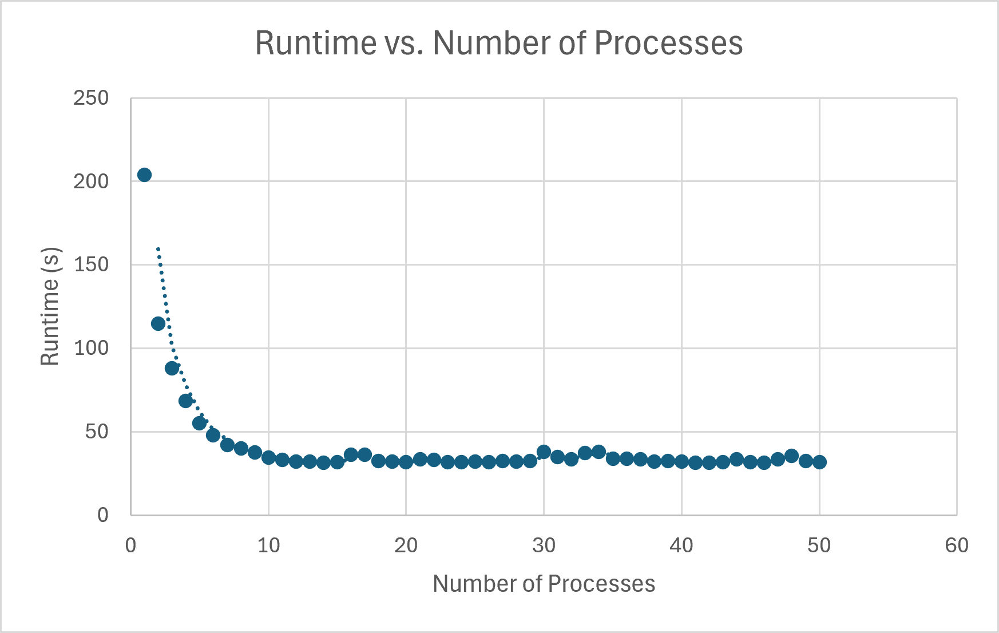

# CPE 2600 - Lab 11: Multiprocessing

**Name:** Yousef Qamhia  

## Description

This lab adds multiprocessing to `mandel.c` using `fork()` and `wait()`. The `-p` option generates 50 Mandelbrot images and limits how many child processes run at once.

## Running

```bash
make
./mandel -p 5 -x -0.7435 -y 0.1314 -s 0.5

```

To create the movie after generating the images:
ffmpeg -i mandel%d.jpg mandel.mpg

```bash
ffmpeg -i mandel%d.jpg mandel.mpg

ffplay mandel.mpg
```

To play the movie:

```bash
ffplay mandel.mpg
```


## Runtime Results

